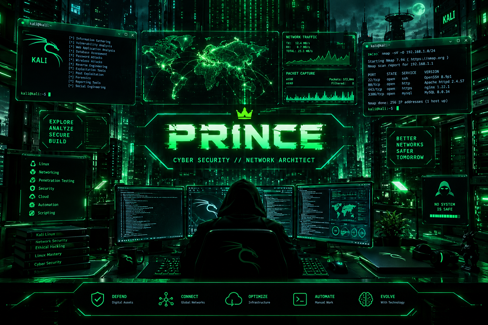

  

<h1 align="center">🏴‍☠️ Prince // Cyber Security Specialist & Network Architect</h1>

  
  
  

---

### ⚡ Core Arsenal & Tech Stack

| Domain | Tools & Technologies |
| :--- | :--- |
| **Operating Systems** | `Kali Linux` • `Debian` • `Arch Linux` |
| **Networking & Routing** | `Cisco (CCNA)` • `VLANs` • `OSPF` • `NAT/ACL` • `Wireshark` |
| **Offensive Security** | `Nmap` • `Metasploit` • `Burp Suite` • `Vulnerability Assessment` |
| **Scripting & Automation** | `Python` • `Bash` • `Git` |

---

### 📊 GitHub Stats & Streaks

  
  

  

---

<i>"There is no patch for human stupidity, but there is always a backdoor." 🏴‍☠️</i>

